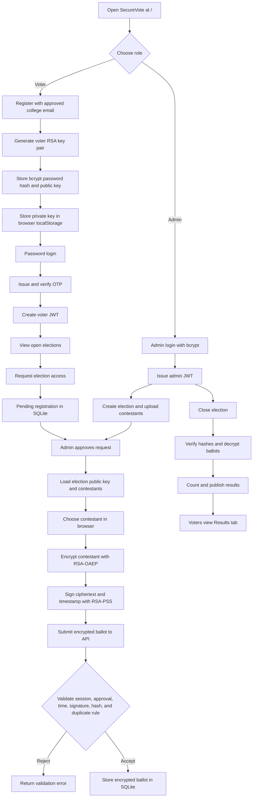

# SecureVote: Secure Digital Voting System

## 1. Title

**Secure Digital Voting System Using Applied Cryptography**  
Review and presentation guide for the SecureVote application.

- Application name: SecureVote
- Application type: Web-based digital voting platform
- Backend: FastAPI and Python
- Frontend: HTML, CSS, and JavaScript
- Database: SQLite
- Security focus: Confidentiality, integrity, authentication, authorization, and auditability

---

## 2. Table of Contents

1. [Title](#1-title)
2. [Table of Contents](#2-table-of-contents)
3. [Abstract](#3-abstract)
4. [Introduction](#4-introduction)
5. [Problem Statement](#5-problem-statement)
6. [Objectives](#6-objectives)
7. [Concepts Used](#7-concepts-used)
8. [Solution Overview](#8-solution-overview)
9. [Implementation](#9-implementation)
10. [Conclusion](#10-conclusion)
11. [References](#11-references)
12. [Review Demonstration Script](#12-review-demonstration-script)
13. [Component Reference](#13-component-reference)

---

## 3. Abstract

SecureVote is a course-scale digital voting platform that demonstrates how applied cryptography can protect an online election workflow. The system supports voter registration, multi-factor login with a one-time password, administrator-controlled elections, voter approval, encrypted ballot submission, digital signature verification, election closing, and result publication.

Each election receives its own RSA key pair. The voter interface encrypts the selected contestant using the election public key before the vote leaves the browser. The voter also signs the encrypted ballot and timestamp with a voter-specific RSA private key. The server validates the voter session, registration approval, signature, timestamp, ballot integrity, and one-vote-per-election rule before storing the ballot.

The project is designed as an educational demonstration rather than a production election service. It shows how several cryptographic controls can be combined with ordinary web application controls to create a layered security design.

---

## 4. Introduction

Traditional paper elections require physical presence, manual administration, and manual counting. A digital election can improve convenience and speed, but it introduces security questions:

- How can the system confirm that only approved voters participate?
- How can a vote remain confidential while it is stored?
- How can the system detect a modified ballot?
- How can the system stop an attacker from submitting a vote as another voter?
- How can the system prevent a voter from voting twice?
- How can administrators manage elections without exposing the ballot choice?

SecureVote addresses these questions with a web interface backed by authenticated API endpoints and a SQLite database. The project separates the user roles clearly:

- **Voter:** registers, logs in, requests election access, votes, and views published results.
- **Administrator:** manages voters, creates elections, approves access requests, closes elections, and publishes results.
- **Voting server:** validates requests, stores encrypted data, verifies signatures, and performs the final tally.

The application is available at `/` and exposes JSON endpoints under `/api`. A `/health` endpoint returns `{ "status": "ok" }` so the running service can be checked quickly.

---

## 5. Problem Statement

A digital voting system must protect the ballot throughout its lifecycle. A naive implementation could store the selected contestant as plaintext, trust a voter ID supplied by the browser, use a reusable password session, or accept any submitted signature. Each of these choices creates a security weakness.

The problem addressed by this project is:

> Design and implement a manageable digital voting workflow in which voter identity and permissions are checked, ballot choices are encrypted before storage, ballot origin is authenticated, stored ballot data can be checked for tampering, duplicate voting is prevented, and results are revealed only after the election is closed.

The project also needs to remain understandable enough for an academic review. Therefore, every important security decision is implemented with standard algorithms and documented in the `docs/` directory.

### Scope and limitations

This implementation is suitable for demonstration and testing. It is not a certification-ready public election system. Production deployment would additionally require hardened secret management, HTTPS configuration, protected key storage, operational monitoring, independent security review, stronger privacy guarantees, and a formal threat model.

---

## 6. Objectives

### Functional objectives

1. Allow only approved college email addresses to register.
2. Store voter passwords as bcrypt hashes rather than plaintext.
3. Authenticate voters with a password and a one-time code.
4. Allow administrators to create elections with dates, category, contestants, and images.
5. Allow voters to request access to a specific election.
6. Allow administrators to approve or reject election registration requests.
7. Encrypt the selected contestant before submitting the ballot.
8. Sign the encrypted ballot and timestamp.
9. Validate the ballot before accepting it.
10. Prevent duplicate voting within an election.
11. Close elections before tallying.
12. Publish results only after a successful tally.
13. Record important security and administrative events in an audit log.

### Security objectives

- **Confidentiality:** the stored vote is ciphertext, not the plaintext contestant choice.
- **Integrity:** a SHA-256 digest detects changes to stored ciphertext.
- **Authentication:** bcrypt validates passwords and JWTs represent authenticated sessions.
- **Authorization:** role-specific dependencies separate voter and administrator operations.
- **Ballot origin:** RSA-PSS verifies that a ballot was signed by the registered voter key.
- **Replay resistance:** the signature includes a timestamp, and the timestamp must be within the election window.
- **Availability of review:** the project includes a browser UI, tests, setup defaults, and a health endpoint.

---

## 7. Concepts Used

### 7.1 FastAPI and REST-style APIs

FastAPI exposes Python functions as HTTP endpoints. The frontend calls the endpoints using `fetch`. JSON is used for authentication, registration, and voting requests. Multipart form data is used when an administrator creates an election with contestant image uploads.

The API is mounted under `/api`. Examples include:

- `POST /api/register`
- `POST /api/login`
- `GET /api/elections`
- `POST /api/elections/{id}/register`
- `POST /api/elections/{id}/vote`
- `POST /api/admin/elections`
- `POST /api/admin/elections/{id}/close`
- `POST /api/admin/elections/{id}/publish-results`

### 7.2 SQLite relational database

SQLite stores structured application data in `data/voting.db` by default. Foreign keys and unique constraints enforce relationships and one-record rules.

Important tables:

| Table | Purpose |
|---|---|
| `voters` | Voter ID, bcrypt password hash, public signing key, and legacy vote flag |
| `admins` | Administrator usernames and bcrypt password hashes |
| `elections` | Election metadata, public/private election keys, dates, close state, and results |
| `contestants` | Candidate names and uploaded image paths for each election |
| `election_registrations` | Pending, approved, or rejected voter access requests |
| `election_votes` | Encrypted ballot, signature, integrity hash, timestamp, and voter public-key snapshot |
| `voter_login_otps` | Hashed OTPs, expiry time, and consumed state |
| `audit_log` | Security and administrative events with timestamps |
| `meta` | Migration and compatibility metadata |

### 7.3 RSA-2048 key pairs

The system generates RSA key pairs with a 2048-bit modulus and public exponent 65537.

There are two key contexts:

- **Election key pair:** the election public key encrypts ballots; the election private key decrypts ballots during tallying.
- **Voter key pair:** the voter private key signs submissions; the voter public key verifies the signature.

A new election receives its own key pair. This prevents one election's private key from being used to decrypt another election's ballots.

### 7.4 RSA-OAEP encryption

RSA-OAEP with SHA-256 encrypts the ballot plaintext. In the browser, the plaintext is JSON such as:

```json
{"contestant_id": 1}
```

The ciphertext is Base64 encoded for transport and storage. OAEP uses randomized padding, so encrypting the same plaintext does not produce a predictable repeated ciphertext.

### 7.5 RSA-PSS digital signatures

The browser signs this exact UTF-8 message:

```text
encrypted_vote_base64 | timestamp
```

RSA-PSS with SHA-256 is used for the signature. The server verifies it using the voter's public key. If either the ciphertext or timestamp changes after signing, verification fails.

### 7.6 SHA-256 integrity hashing

The server calculates SHA-256 over the decoded encrypted vote bytes. The resulting hexadecimal digest is stored beside the ballot. During tallying, the digest is recalculated and compared before decryption.

A hash does not authenticate a sender by itself. That is why the design uses SHA-256 for integrity and RSA-PSS for ballot origin authentication.

### 7.7 bcrypt password hashing

Passwords are processed with bcrypt using a cost factor of 12. The database stores only the bcrypt result. During login, bcrypt verifies the supplied password against the stored hash.

### 7.8 JWT bearer sessions

After successful authentication, the server returns a JWT containing:

- `sub`: the voter ID or administrator username
- `role`: `voter` or `admin`
- `iat`: issue time
- `exp`: expiry time

The browser stores the token in `localStorage` for this demonstration and sends it as a Bearer token. Server dependencies reject missing, invalid, expired, or wrong-role tokens.

### 7.9 OTP authentication

Voter login is a two-step process:

1. The password is checked.
2. The server creates a six-digit OTP and stores only its SHA-256 hash with an expiry time.

In demo mode, the OTP is logged and returned in the response so the review can proceed without email infrastructure. In SMTP mode, the OTP is sent through the configured email server and is not exposed in the response when the production setting is used.

### 7.10 Defense against replay and duplicate voting

The vote endpoint checks several conditions:

- The JWT subject matches the `voter_id` in the request.
- The voter has an approved registration for the election.
- The election is currently open.
- The timestamp is valid and within the election window.
- The signature is valid.
- The encrypted ballot integrity hash is valid.
- The voter has not already submitted a ballot for that election.
- The selected contestant belongs to that election.

---

## 8. Solution Overview

SecureVote uses a layered architecture:

```text
Browser UI
  |
  | HTML, CSS, JavaScript, browser localStorage
  v
FastAPI application
  |
  | authentication, authorization, validation, crypto verification
  v
SQLite database + uploads directory
  |
  | encrypted ballots, keys, registrations, audit events, images
  v
Administrator tally and published results
```

### Main design decision

The ballot is encrypted in the browser before the vote request is sent. The server receives the encrypted choice and can verify the voter's signature, but it does not need to store a plaintext contestant choice.

### Trust boundaries

1. **Browser to server:** the server must treat all browser input as untrusted.
2. **Voter to administrator:** voters can request access but cannot approve themselves.
3. **Open election to closed election:** ballots can be submitted only while an election is active.
4. **Closed election to published result:** the administrator must close and tally before voters see counts.
5. **Configuration to application:** allowlists, JWT secrets, admin credentials, OTP mode, and database paths come from configuration.

### Current review/demo configuration

The local project runs with development defaults when no `.env` file is present:

- URL: `http://127.0.0.1:8000/`
- Database: `data/voting.db`
- Admin username: `admin`
- Admin password: `admin-change-me`
- OTP mode: demo
- Default allowlisted users: four `@umsystem.edu` addresses

These values are for the local academic demonstration only and must be changed for deployment.

---

## 9. Implementation

### 9.1 Project components

#### `src/main.py`

Creates the FastAPI application and connects the major pieces.

Responsibilities:

- Creates the application object.
- Runs startup initialization through the lifespan handler.
- Creates the data and uploads directories.
- Calls `ensure_bootstrap` to initialize the schema and administrator.
- Mounts `/static` for CSS and JavaScript.
- Mounts `/uploads` for contestant images.
- Serves `templates/app.html` at `/`.
- Provides `/health`.

#### `src/api_routes.py`

Contains the application API and most workflow rules.

Responsibilities:

- Defines Pydantic request models.
- Normalizes and allowlist-checks voter emails.
- Handles voter registration and login.
- Issues and validates OTPs.
- Handles administrator login and first-admin setup.
- Lists elections and details.
- Creates elections and stores contestant images.
- Receives election registration requests.
- Approves and rejects voter requests.
- Receives and validates encrypted ballots.
- Closes elections and publishes results.
- Provides administrative statistics and voter deletion support.
- Writes audit events for significant actions.

#### `src/crypto_service.py`

Centralizes cryptographic operations so the API and tests use the same primitives.

Functions include:

- RSA key-pair generation.
- bcrypt password hashing and verification.
- SHA-256 digest calculation.
- RSA-OAEP encryption and decryption.
- RSA-PSS signing and signature verification.
- ISO-8601 timestamp parsing.

#### `src/auth_tokens.py`

Creates and validates JWT sessions using the configured secret and algorithm. It provides safe decoding that returns `None` rather than allowing an invalid token to crash a request.

#### `src/database.py`

Defines the SQLite schema, connection helper, foreign-key activation, migrations, metadata helpers, audit logging, and election lookup.

The connection helper sets `row_factory` to `sqlite3.Row`, which lets API code access database values by column name.

#### `src/bootstrap.py`

Runs at application startup. It:

- Creates all required tables.
- Performs legacy schema migrations.
- Adds the configured administrator if needed.
- Synchronizes the configured admin password when enabled.
- Removes voter rows that are no longer on the configured allowlist.
- Logs startup and migration events.

#### `src/config.py`

Loads configuration from `.env` and environment variables using Pydantic Settings. It controls database paths, JWT settings, administrator credentials, allowlisted emails, OTP behavior, SMTP configuration, and election defaults.

#### `templates/app.html`

Provides the single-page HTML shell. It contains sections for:

- Voter/admin login.
- First administrator setup.
- Voter registration.
- Voter dashboard.
- Election discovery.
- Ballot history.
- Results.
- Admin overview.
- Admin approvals.
- New election form.
- Election management and publishing.

#### `static/js/app.js`

Implements browser behavior and API calls.

Important responsibilities:

- Switches between login, registration, voter, and admin views.
- Stores JWTs and the voter signing key in browser localStorage.
- Performs the OTP login step.
- Restores a missing voter signing key after password verification.
- Requests election access.
- Encrypts the contestant ID with RSA-OAEP.
- Signs the encrypted value and timestamp with RSA-PSS.
- Submits the encrypted vote.
- Loads ballots, elections, approvals, statistics, and results.

#### `static/css/app.css`

Defines the visual presentation of the application: layout, typography, dark review interface, tabs, dashboards, election cards, buttons, forms, statuses, contestant tiles, and result bars.

#### `requirements.txt`

Pins the runtime and development dependencies:

- FastAPI and Uvicorn for the web service.
- Jinja2 for templates.
- python-multipart for file uploads.
- cryptography and bcrypt for security primitives.
- python-jose for JWT handling.
- Pydantic and pydantic-settings for validation/configuration.
- HTTPX and pytest for tests.

#### `scripts/demo_flow.py`

Contains an older API demonstration script showing the intended story: registration, login, encrypted vote, administrator login, election closing, and tallying. The current multi-election browser workflow in `app.js` is the primary review path.

#### `tests/`

Contains unit and API tests.

- `test_crypto_service.py` checks RSA key generation, bcrypt, OAEP, SHA-256, RSA-PSS, tampering, and wrong-key failures.
- `test_api.py` checks registration, OTP login, election creation, approval, voting, duplicate-vote blocking, invalid signatures, closing, publishing, key restoration, and authorization.
- `helpers.py` creates test elections and test ballots.
- `conftest.py` isolates tests in temporary databases and configures test allowlists/secrets.

#### `docs/`

Contains the design and security explanation used to justify the implementation:

- `crypto_design_decisions.md`: algorithm choices and misuse prevention.
- `key_lifecycle.md`: key generation, storage, usage, rotation, compromise, and destruction plans.
- `interface_spec.md`: endpoint fields and validation rules.
- `attack_simulation.md`: signature forgery, tampering, replay, and duplicate-vote defenses.
- `review_guide.md`: this presentation and review guide.

### 9.2 Voter registration workflow

1. The voter opens the registration form.
2. The browser sends `POST /api/register` with email and password.
3. The server normalizes the email to lowercase.
4. The server checks the `@umsystem.edu` format and configured allowlist.
5. The server generates a voter RSA key pair.
6. The server hashes the password with bcrypt.
7. The server stores the voter ID, password hash, and public key in `voters`.
8. The server returns the private PEM key once.
9. The browser stores the private key in localStorage for signing future ballots.
10. The browser starts the login/OTP step.

The private key is intentionally not stored in the database by the registration endpoint. If browser storage is cleared, the app can generate a replacement key after password verification.

### 9.3 Voter login workflow

1. The voter submits email and password.
2. The server finds the voter and verifies the bcrypt password.
3. The server generates a six-digit OTP.
4. The server stores an SHA-256 hash of the OTP with an expiry time.
5. The demo mode displays the OTP in the response; SMTP mode sends it by email.
6. The voter submits the OTP.
7. The server checks that it is active, unexpired, correct, and not consumed.
8. The server returns a voter JWT.
9. The browser stores the JWT and opens the voter dashboard.

### 9.4 Administrator workflow

1. The administrator logs in with username and password.
2. The server returns an admin JWT with role `admin`.
3. The administrator creates an election with title, category, open/close times, contestant names, and images.
4. The server generates a new RSA election key pair.
5. The server stores election metadata and the key pair.
6. The server stores contestant images under `data/uploads/{election_id}`.
7. The administrator monitors pending access requests.
8. The administrator approves or rejects each request.
9. The administrator closes the election after voting ends.
10. The administrator publishes results after the encrypted ballots are checked and tallied.

### 9.5 Election access workflow

1. An authenticated voter loads `GET /api/elections`.
2. An open election without a registration shows `Request access`.
3. The voter calls `POST /api/elections/{id}/register`.
4. The server creates a `pending` row in `election_registrations`.
5. The administrator views pending rows.
6. The administrator calls the approve or reject endpoint.
7. The voter dashboard reflects `pending`, `approved`, or `rejected`.

### 9.6 Vote creation in the browser

The browser does the following when a voter selects a contestant:

1. Creates plaintext JSON containing the contestant ID.
2. Loads the election public key from election detail.
3. Encrypts the plaintext with RSA-OAEP and SHA-256.
4. Base64 encodes the ciphertext.
5. Creates an ISO-8601 timestamp.
6. Signs `encrypted_vote_base64|timestamp` with the voter's private RSA key using RSA-PSS and SHA-256.
7. Sends the voter ID, ciphertext, signature, and timestamp to the API.

The UI does not send the plaintext contestant selection.

### 9.7 Vote validation on the server

The vote endpoint verifies:

1. A valid voter JWT exists.
2. The JWT subject equals the submitted voter ID.
3. The voter is approved for the election.
4. The election exists and is open.
5. The timestamp parses and falls within the election window.
6. The signature verifies against the stored voter public key.
7. The ciphertext integrity hash is calculated and stored.
8. The decrypted contestant ID exists in the selected election.
9. No previous ballot exists for the same voter and election.
10. The encrypted ballot, signature, hash, timestamp, and public-key snapshot are stored.

### 9.8 Tally and results workflow

1. The administrator closes the election.
2. New voting requests are rejected.
3. The administrator requests result publication.
4. The server verifies each stored ballot's integrity hash.
5. The server decrypts each ballot with the election private key.
6. The server validates the selected contestant ID.
7. The server counts valid votes by contestant.
8. The server stores a result summary in `results_json`.
9. The server marks `results_announced` as true.
10. Voters can load the published result counts.

### 9.9 Implementation flow diagram



### 9.10 Security attack demonstration

The project documents a signature replay and forgery scenario in `docs/attack_simulation.md`.

- A random or wrong-voter signature is rejected.
- Changing the timestamp after signing invalidates the signature.
- Reusing an old ballot outside the election window is rejected.
- A second ballot for the same voter and election is rejected.
- A voter cannot submit a different `voter_id` from the JWT subject.

A useful review explanation is:

> The system does not trust a voter ID by itself. It binds the voter ID to a JWT, binds the ballot to the voter's public key through RSA-PSS, binds the payload to a timestamp, and then enforces the election and duplicate-vote rules at the database/API layer.

### 9.11 Testing evidence

The test suite validates 31 cases in the current project state. It covers:

- Cryptographic round trips.
- Password hashing and wrong-password rejection.
- Ciphertext tampering.
- Wrong signature keys.
- Timestamp tampering.
- Wrong decryption keys.
- Full registration-to-results flow.
- Allowlist enforcement.
- OTP login.
- Admin authorization.
- Election access approval.
- Invalid signatures.
- Duplicate-vote blocking.
- Results publication only after closure.
- Signing-key restoration.
- Health and home page availability.

The local verification command is:

```powershell
.\.venv312\Scripts\python.exe -m pytest -q
```

---

## 10. Conclusion

SecureVote demonstrates a complete multi-election digital voting workflow using applied cryptography and web application security controls. The project combines:

- bcrypt for password protection.
- OTPs for an additional login step.
- JWTs for role-based sessions.
- RSA-OAEP for ballot confidentiality.
- RSA-PSS for ballot-origin authentication.
- SHA-256 for encrypted-ballot integrity.
- SQLite constraints and API checks for workflow enforcement.
- Audit logging for traceability.

The most important design property is that the voter choice is encrypted before it is submitted. The server can authenticate the voter and validate the ballot without treating the plaintext choice as ordinary request data.

For a review, the strongest demonstration is the complete story:

> Register voter -> verify OTP -> create election -> request access -> approve voter -> encrypt and sign vote -> close election -> tally -> publish results.

The project meets its educational objective: it shows how multiple cryptographic primitives work together with authentication, authorization, database constraints, and workflow state to protect an online voting process.

The system should still be described honestly as an academic prototype. Production use would require stronger operational controls, secure key management, HTTPS, external security testing, and formal election-grade privacy and verifiability guarantees.

---

## 11. References

1. Project README: `README.md`
2. Cryptographic design decisions: `docs/crypto_design_decisions.md`
3. Key lifecycle plan: `docs/key_lifecycle.md`
4. Interface specification: `docs/interface_spec.md`
5. Attack simulation: `docs/attack_simulation.md`
6. FastAPI documentation: https://fastapi.tiangolo.com/
7. Python `cryptography` documentation: https://cryptography.io/
8. Python bcrypt documentation: https://github.com/pyca/bcrypt/
9. Python-JOSE documentation: https://python-jose.readthedocs.io/
10. RFC 8017, PKCS #1 v2.2: RSA cryptography specifications
11. NIST FIPS 180-4: Secure Hash Standard
12. NIST FIPS 186-4: Digital Signature Standard

---

## 12. Review Demonstration Script

Use this sequence during the live review. It keeps the explanation aligned with the application screens.

### Part A: Explain the landing page

- Open `http://127.0.0.1:8000/`.
- Point out the separate Voter and Admin login tabs.
- Explain that the browser is only a client; all important authorization checks are repeated by the server.

### Part B: Demonstrate the voter

- Use an allowlisted email such as `bayd6@umsystem.edu`.
- Register or sign in.
- Explain that registration stores a bcrypt password hash and voter public key.
- Show the demo OTP step.
- Explain that the private signing key is kept in browser localStorage for this prototype.

### Part C: Demonstrate the administrator

- Open the Admin tab.
- Sign in with the configured admin account.
- Open **New election**.
- Show the demo election titled **SecureVote Demo Election - Review**.
- Explain that each election gets a separate RSA key pair.

### Part D: Demonstrate access approval

- As voter, click **Request access**.
- As admin, open **Approvals**.
- Approve the pending request.
- Explain that registration approval is separate from account creation.

### Part E: Demonstrate the cryptographic vote

- Return to the voter dashboard.
- Open the approved election.
- Select a contestant.
- Explain that JavaScript creates `{"contestant_id": ...}`, encrypts it using RSA-OAEP, and signs the ciphertext plus timestamp using RSA-PSS.
- Submit the vote and open **My ballots**.

### Part F: Demonstrate tally and results

- As admin, close the election.
- Publish results.
- Return to the voter **Results** tab.
- Explain that results are unavailable before publication and that only valid, integrity-checked ballots are counted.

### Short presentation statement

> SecureVote protects the voting workflow in layers. Authentication proves who the user is, authorization determines what that user may do, RSA-OAEP hides the vote choice, RSA-PSS proves ballot origin, SHA-256 detects storage tampering, and the database workflow prevents unauthorized or duplicate voting.

---

## 13. Component Reference

| Component | Role in the review |
|---|---|
| `src/main.py` | Application assembly, startup, static files, templates, health endpoint |
| `src/api_routes.py` | Registration, login, elections, approvals, voting, tally, results |
| `src/crypto_service.py` | RSA, bcrypt, SHA-256, timestamp helpers |
| `src/auth_tokens.py` | JWT creation and validation |
| `src/database.py` | SQLite schema, migrations, connections, audit log |
| `src/bootstrap.py` | Startup schema initialization and admin setup |
| `src/config.py` | Environment and `.env` configuration |
| `templates/app.html` | Single-page application structure |
| `static/js/app.js` | UI state, browser cryptography, API calls |
| `static/css/app.css` | Visual design and responsive dashboard styling |
| `data/voting.db` | Local runtime database |
| `data/uploads/` | Contestant image files |
| `scripts/demo_flow.py` | Scripted/legacy API demonstration |
| `tests/test_crypto_service.py` | Primitive-level security tests |
| `tests/test_api.py` | End-to-end workflow and authorization tests |
| `requirements.txt` | Exact runtime and test dependencies |
| `pytest.ini` | Test discovery and Python path configuration |
| `docs/` | Design decisions, interface rules, key lifecycle, attacks, and this guide |
